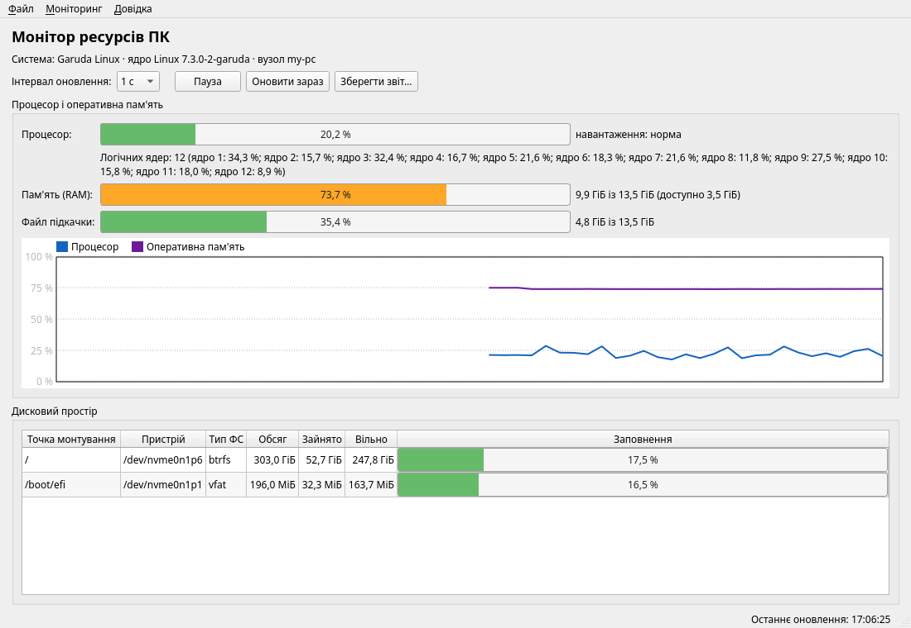

# PC Resource Monitor (CPU, RAM, disk)

**English** · [Українська](README.uk.md)

A desktop app for Linux and Windows. It shows:

- CPU load, in total and per core;
- RAM and swap usage;
- how full each disk is.

It is written in C++17 with Qt 6 (Core, Widgets) and built with CMake. The interface
is in Ukrainian.

## Features

- Live usage bars, colored by load level: normal, high (≥ 70 %), critical (≥ 90 %).
- A history chart of CPU and RAM usage.
- A disk table with mount point, device, file system, size, used and free space.
- Update interval of 1, 2, 5 or 10 s, plus pause and "refresh now".
- Saving a text report. The same report is printed by `resource-monitor --report`
  without opening the window.
- Keyboard navigation and Ukrainian system dialogs (when Qt translations are installed).

## Download

Ready-made builds are in [Releases](https://github.com/Tern1277/resource-monitor/releases/latest):

- **Windows**: `ResourceMonitor-windows-x64.zip`. Unzip it and run `resource-monitor.exe`.
  The file is not code-signed, so SmartScreen may warn you: *More info → Run anyway*.
- **Linux**: `ResourceMonitor-x86_64.AppImage`. Run
  `chmod +x ResourceMonitor-x86_64.AppImage`, then start the file.

## Building

**Linux** (Ubuntu 24.04 / Linux Mint 22):

    sudo apt install build-essential cmake qt6-base-dev qt6-translations-l10n
    cmake -S . -B build -DCMAKE_BUILD_TYPE=Release
    cmake --build build -j
    ctest --test-dir build --output-on-failure
    ./build/resource-monitor            # GUI
    ./build/resource-monitor --report   # one-off text report

**Windows**: install Qt 6 (MSVC 2022 64-bit) and Visual Studio 2022. Then open
`CMakeLists.txt` in Qt Creator, or run the same `cmake` commands from a
*Developer PowerShell*.

## How it works

| Part | What it does |
|---|---|
| `src/core/systemreader.cpp` | Shared code: text parsing, percentages, load levels. Covered by unit tests on prepared input |
| `src/core/systemreader_linux.cpp` | Reads `/proc/stat`, `/proc/meminfo`, `/proc/self/mounts` and calls `statvfs()` |
| `src/core/systemreader_win.cpp` | Calls `GetSystemTimes()`, `NtQuerySystemInformation()` (per core), `GlobalMemoryStatusEx()` and `GetDiskFreeSpaceExW()` |
| `src/core/resourcemonitor.cpp` | Takes timed snapshots and computes CPU load from the difference between two samples |
| `src/gui/` | Main window and history chart |
| `tests/` | Qt Test unit tests |

Both platforms fill the same structures (`CpuTimes`, `MemoryInfo`, `DiskInfo`), so
the rest of the program doesn't depend on the OS.

On Windows, swap is estimated from the commit limit minus physical RAM.

GitHub Actions (`.github/workflows/release.yml`) builds and tests on Windows and
Linux. When a `v*` tag is pushed, it attaches the `.zip` and the AppImage to a release.

## License

[MIT](LICENSE)
