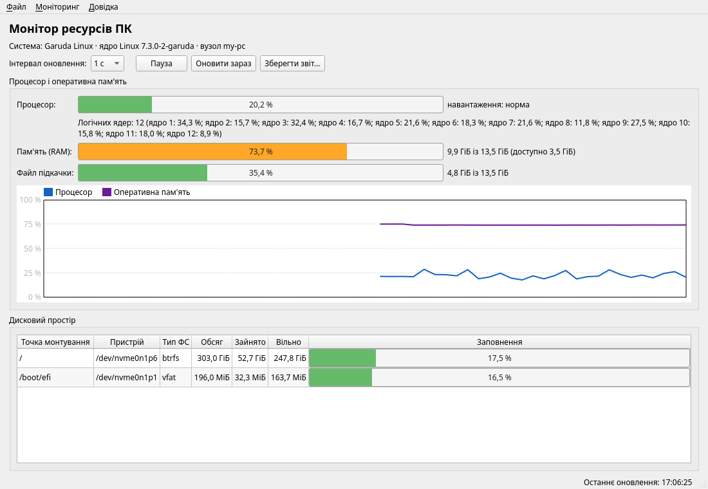

# Монітор ресурсів ПК (CPU, RAM, диск)

[English](README.md) · **Українська**

Настільна програма для Linux і Windows, що показує завантаження процесора
(загальне та за ядрами), використання оперативної пам'яті й файлу підкачки та
заповненість дисків. Мова C++17, бібліотека Qt 6 (Core, Widgets), CMake.

## Завантаження

Готові збірки є в [Releases](https://github.com/Tern1277/resource-monitor/releases/latest):

- **Windows**: `ResourceMonitor-windows-x64.zip`. Розпакуй архів і запусти
  `resource-monitor.exe`. Файл не підписаний, тому SmartScreen може попередити:
  *Докладніше → Усе одно запустити*.
- **Linux**: `ResourceMonitor-x86_64.AppImage`. Виконай
  `chmod +x ResourceMonitor-x86_64.AppImage`, потім запусти файл.

## Залежності для збирання (Ubuntu 24.04 LTS / Linux Mint 22)

    sudo apt install build-essential cmake qtcreator \
        qt6-base-dev qt6-translations-l10n

На Windows знадобляться Qt 6 (MSVC 2022 64-bit) з офіційного інсталятора і Visual Studio 2022.

## Збирання в Qt Creator

1. File > Open Project (Ctrl+Shift+O) і вибрати файл CMakeLists.txt.
2. На вкладці Configure Project вибрати комплект Qt 6 і натиснути Configure Project.
3. Ctrl+B — зібрати, Ctrl+R — запустити ціль resource-monitor.
4. Тести: Tools > Tests > Run All Tests або запуск цілі test_core.

## Збирання з термінала

    cmake -S . -B build -DCMAKE_BUILD_TYPE=Release
    cmake --build build -j
    ctest --test-dir build --output-on-failure
    ./build/resource-monitor            # графічний режим
    ./build/resource-monitor --report   # текстовий звіт у консоль

## Структура

    src/core  — збирання даних
                  systemreader.cpp        розбір тексту, відсотки, рівні (спільне)
                  systemreader_linux.cpp  /proc/stat, /proc/meminfo, /proc/self/mounts, statvfs
                  systemreader_win.cpp    GetSystemTimes, NtQuerySystemInformation,
                                          GlobalMemoryStatusEx, GetDiskFreeSpaceExW
    src/gui   — головне вікно та графік історії
    tests     — модульні тести Qt Test
    packaging — ярлик і значок (Linux / AppImage)

Збірки для Releases робить GitHub Actions (`.github/workflows/release.yml`), коли
в репозиторій пушать тег `v*`.

## Ліцензія

[MIT](LICENSE)
